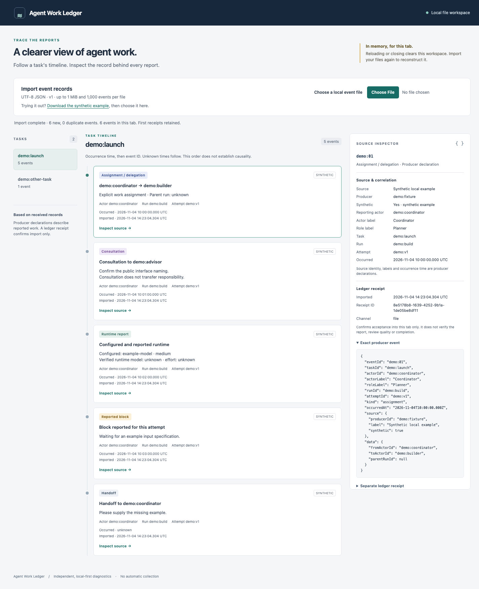

# Agent Work Ledger

A local-first diagnostic tool for agent work. Import structured event files, follow a task's timeline and inspect the source behind every report—without an AI service or an external account.

The local file timeline is implemented. Independent review, integrated QA and the first user evaluation are separate acceptance gates. Graphs, persistent storage and real producer reporting are later results; there is no event collector or live agent connection.

## Run locally

Requires CPython **3.12** and a desktop Chromium browser. The author checked Python **3.12.0**, Chromium **156.0.8078.4**, macOS **26.6.2 arm64**. Other platforms/browser versions are not yet verified. No package installation, build, framework or CDN is needed.

From the repository root:

```sh
python3.12 -m http.server 8774 --bind 127.0.0.1 --directory web
```

Open [the local timeline](http://127.0.0.1:8774/). Keep the terminal running; stop the dedicated server with **Ctrl-C**. Serve only `web`, never the repository root. This loopback static server is for local inspection, not production hosting. Do not open `index.html` directly as a `file://` URL; ES modules need the local server.

## Try the synthetic example

1. In the app, choose **Download the synthetic example**, then use **Choose a local event file** to select the downloaded JSON. Alternatively, select `web/examples/synthetic-timeline.json` directly from this checkout. The example uses the ordinary import path and is never loaded automatically.
2. Select task **demo:launch**. Find the assignment from **demo:coordinator → demo:builder**, the separate consultation to **demo:advisor**, and the reported block **Waiting for an example input specification.**
3. Find the runtime report: configured model **example-model**, configured effort **medium**; verified runtime model and effort **unknown**. Configured values do not establish what actually ran.
4. Activate **Inspect source** for any event. The inspector shows its exact parsed producer JSON, source/synthetic labels, run/attempt references and a separate ledger receipt. Keyboard users can Tab to an inspection button and press Enter; focus moves to the inspector. **Return to selected event** moves it back.
5. Compare **Occurred** (producer-reported) with **Imported** (local acceptance). The handoff has unknown occurrence time and sorts last. Select **demo:other-task** to see the independent task.
6. Choose the same file again: **0 new, 6 duplicate events**, with first receipt IDs/times retained. After the example, selecting `web/tests/import/malformed.json` or `web/tests/import/conflict.json` produces an actionable error and preserves the previous workspace.
7. Reload the page: the workspace is empty. Choose the original example again to reconstruct its records.



These are suggested evaluation steps, not a completed user trial. The synthetic example demonstrates interpretation, not real agent reporting.

## Input and trust boundary

Files are v1 UTF-8 JSON envelopes with at most **1 MiB (1,048,576 encoded bytes)** and **1,000 events per import**, including duplicate occurrences. Invalid UTF-8, a leading BOM, malformed JSON, repeated object keys, unknown fields or conflicting event IDs reject the entire import. The [event contract](docs/event-contract.md) defines exact fields, kinds, IDs, calendar timestamps and nullable values. The app reads file bytes directly and reports validation errors without echoing raw input.

Imports accumulate only in the current tab's memory. Reloading or closing loses the session; keep your original files and import them again. No browser storage, backend, automatic collection, outgoing remote requests or AI analysis is used in ordinary viewing. Imported files stay in the browser. Use structured diagnostic metadata only; do not import secrets, transcripts, prompts or private conversation content.

All event content is a **producer declaration**, including reported tool verification. A **ledger receipt** confirms local import only. It does not certify truth, review quality, independence or completion. Unknown stays unknown, multiple runtime reports stay separate, and no live status, current owner or graph is inferred. Occurrence-time ordering is a presentation convention, not proof of causality.

## Checks and development

Open [the browser import checks](http://127.0.0.1:8774/tests/import/) with the same server running; inspect its completed `TOTAL / PASS / FAIL / SKIP` report. The dependency-free module and stable consumer boundary are documented in [import API](docs/import-api.md). [UI author evidence](web/tests/ui/evidence.md) records actual application checks, versions, exact commands, failures/reruns, screenshots and limits. The optional UI runner needs Node 22+ with built-in WebSocket and an explicitly selected isolated Chromium executable; neither is required to run the app.

The [product brief](docs/product-brief.md) explains purpose and trust boundaries; the [technical plan](docs/technical-plan.md) describes the local slices and later verification. Agent Work Ledger is independent of any software factory, role taxonomy, tracker or agent provider.

Licensed under [MIT](LICENSE).
