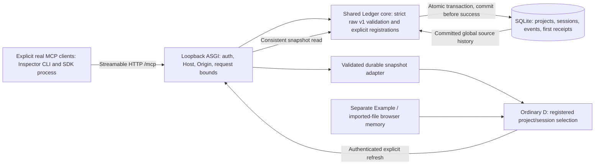

# DAM-32 architecture and evidence boundary

**Tech Lead · gpt-6.1-sol · medium (configured)**

[Agreed FigJam board, section 1:27](https://www.figma.com/board/W42GpS1NCEtG34mlKS60PL?node-id=1-27). On 2026-11-04 the section was readable, but its update attempt returned: “You've reached the Figma MCP tool call limit on the Starter plan.” No write succeeded; the board still carries stale earlier labels. This versioned diagram is the accessible source fallback, not a claim of an updated board. Keep the same board for later reconciliation when access permits; do not purchase quota or create a replacement board.

**Implemented at contract base:** browser importer, pure relation projection, ordinary D and separate memory workspaces at `9656cc61e51d804b6e63f9518deaf1ce06171489`; DAM-30 acceptance supplied by delivery owner. **Planned:** all new Ledger/storage/MCP/UI-adapter paths. **Probe verified:** official SDK2 and Inspector clients each completed a synthetic echo tool call over real loopback HTTP, SDK negotiated 2026-07-28; this was a disposable dependency probe, with no Ledger/database/product UI. **Not yet verified:** product persistence, crash recovery, registrations, installation package, durable D, independent QA and user trial. The [service contract](ledger-api.md) is authoritative; the diagram does not replace it.

DAM-37 owns shared core/storage and preintegration persistence QA. DAM-38 consumes that accepted contract/core and owns MCP/ASGI/authenticated reads, safe hydration, minimal D integration and public local install. DAM-32 owns integrated independent QA and ordinary user trial. DAM-39 later tests the same core/package behind an isolated TLS/proxy/self-hosted boundary; actual VPS rollout is excluded. DAM-40 adds richer day/project browsing separately. Studio instructions/integration follow independent MCP acceptance and are outside these product paths.
