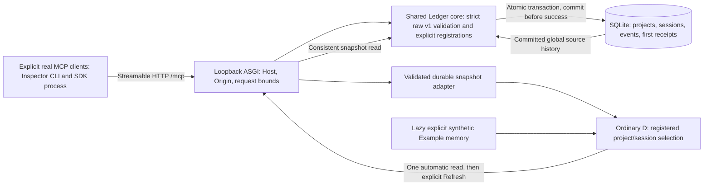

# DAM-32 architecture and evidence boundary

**Tech Lead · gpt-6.1-sol · medium (configured)**

[Agreed FigJam board, section 1:27](https://www.figma.com/board/W42GpS1NCEtG34mlKS60PL?node-id=1-27). On 2026-11-04 the section was readable, but its update attempt returned: “You've reached the Figma MCP tool call limit on the Starter plan.” No write succeeded; the board still carries stale earlier labels. This versioned diagram is the accessible source fallback, not a claim of an updated board. Keep the same board for later reconciliation when access permits; do not purchase quota or create a replacement board.

**Implemented source:** accepted browser importer/projector/ordinary D at `9656cc6`, independently reviewed/tested DAM-37 core at `ba50cf7`, and DAM-38 local MCP/read/package/durable adapter/chooser in this revision. **Author runtime verified:** installed package launched outside checkout; separate official SDK2 and Inspector2.13 clients registered two projects/sessions and committed the synthetic journey through real `/mcp`; global snapshot retained original receipts through restart/retry; isolated Chromium read those sources and retained stale state through actual dedicated service stop/restart. Author tests also exercise transport rejection, streamed body bounds and malicious raw snapshot hydration. Reproducible commands are in [service checks](../tests/service/README.md) and [public setup](local-service.md). **Historical probe only:** the earlier SDK/Inspector echo did not prove these product paths. **Not accepted by these author checks:** independent integrated DAM-32 QA, ordinary user trial, remote deployment/hosted agents, broader platform/security claims. The [service contract](ledger-api.md) remains authoritative.

DAM-37 owns shared core/storage and preintegration persistence QA. DAM-38 consumes that accepted contract/core and owns MCP/ASGI/local reads, safe hydration, minimal D integration and public local install. DAM-32 owns integrated independent QA and ordinary user trial. DAM-39 later tests the same core/package through a separately validated private loopback/SSH-tunnel boundary; actual VPS rollout is excluded. DAM-40 adds richer day/project browsing separately. Studio instructions/integration follow independent MCP acceptance and are outside these product paths.

Owner-directed local defaults: saved named projects/sessions open automatically with one real snapshot read; no polling, file-import UI or Task ID search. Example is only under closed Diagnostics. There is no application authentication/token/account/browser persistence. Any local connector can access the ledger; producer labels and projects are not access boundaries. Exact Host/present-Origin applies before every route including fixed assets; no CORS/proxy trust/remote bind. Core/storage/schema/first receipts are unchanged. No public HTTP hosting or tunnel implementation is claimed. Old credential/config files become unused and are left untouched.
