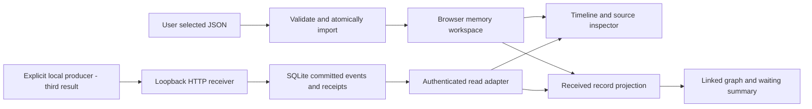

# Technical plan — local diagnostic slices

**Tech Lead · gpt-6.1-sol · medium (configured)**

Local file import, timeline and source inspection are implemented for review, with author checks recorded in [UI evidence](../web/tests/ui/evidence.md). Independent source review, integrated QA and user evaluation remain separate gates. The later graph/receiver/producer slices below are plans, with no collector or deployment. [Product brief](product-brief.md) defines value and scope; [event contract v1](event-contract.md) defines interoperability. Delivery selection and progress belong to the issue tracker, not this document.

## Decisions and smallest trial

Choose plain HTML/CSS and JavaScript ES modules, with no UI framework, bundler, AI dependency or external CDN. First evaluation target is a desktop Chromium browser on macOS; record the actual browser/OS version during verification. Choose CPython 3.12 as the initial documented runtime target; record and test the exact installed patch version before claiming support. No runtime installation is authorized by this plan.

First result: serve only public UI assets from a dedicated web directory over 127.0.0.1 using the standard-library static server. Local File API selection loads the public synthetic JSON example into browser memory. No backend ingestion or database exists. Reload/close clears the session and the UI must say so; reopen the unchanged source file to reconstruct it. This deliberate boundary avoids building a persistence engine before validating interpretation. Atomic imports retain the prior session on error; successful repeated imports retain one event per identity. The user identifies delegation, reported block and unknown runtime model in one timeline.

Second result: keep that same input and memory boundary. Add deterministic graph/state projections and linked views for one selected task. A basic labelled SVG/list graph with keyboard-accessible source links is enough; no layout engine, live updates or general dashboard. Import-order, partial references and competing assertions are the main risks.

Third result: add a small Python loopback receiver and SQLite storage, plus a same-origin read adapter for the existing viewer. Use standard-library HTTP request handling, sqlite3, unittest and a separate Python producer process using urllib. The producer submits explicit opt-in structured events for one safe bounded chain; this is a real process/socket/commit path, not a fixture loaded into memory. Keep file workspace and durable workspace visibly distinct. One process/database and serialised writes suffice; no queue, daemon management, discovery or multi-client guarantee. Protect localhost reads/writes as specified in the contract. This is a local evaluation receiver, not production web hosting.

MCP is deferred beyond all three results. File import proves interpretation; a plain HTTP producer proves actual receipt, retry and restart with fewer integration assumptions. A reusable reporting skill and MCP adapter are separate later outcomes, only after the core and public reporting instructions are independently tested. Their smallest later trial should be one explicitly configured MCP client calling the same receipt interface, repeating one ID and inspecting the persisted event. They add host/tool registration and adapter error semantics, so including them now would enlarge the third result without improving its required trial. No factory integration or existing pipeline changes belong to this delivery.

## Planned architecture

The File → Import → Memory → Views path is implemented; its author checks do not substitute for independent acceptance. Projection/Graph and the producer/receiver/database/read path remain planned. Browser memory and SQLite are distinct workspaces, not synchronized stores. The diagram is a review artifact, not evidence of runtime behavior.

Keep three deep modules with small interfaces: import accepts previous events plus envelope and returns an unchanged/error or accepted snapshot/receipt summary; projection accepts a snapshot and returns linked evidence/diagnostics; durable receipt accepts an envelope and returns committed receipt or explicit error. Time/receipt ID sources are injected for deterministic tests. Do not introduce provider plugins or repository abstractions before they vary. Browser and Python validation use the same contract golden fixtures; receipt data never contaminates event equality. Tests cross these interfaces rather than inspecting private structures.

## Delivery ownership and integration

Each future technical scope is owned by its assigned implementation author; a delivery owner integrates the child results and exposes the ordinary local application. Each child requires independent source review before integration. Parent acceptance additionally requires independent runtime QA and the actual user trial; child completion cannot substitute for it. Subsequent product results wait for acceptance of the preceding result. No implementation is started by this plan.

| Product result | Independently owned technical outputs | Shared acceptance/evidence |
| --- | --- | --- |
| Local timeline | Import/equality/ordering module with golden synthetic files; browser timeline/source view and public local setup | Ordinary file selection, atomic malformed/conflict handling, repeat/tied/out-of-order events, declared/unknown facts; first user trial |
| Linked chain | Pure relation/wait/revision projection; linked graph/summary presentation with extended synthetic files | Source correspondence, consultation versus assignment, unresolved/invalid/cyclic relations, ambiguous next actor, revision-specific review/QA |
| Real local receipt | HTTP/SQLite receipt and recovery module; real Python producer/public instructions and viewer read adapter | Real process/socket→commit→view, retry and restart, errors/disconnect, declarations remain declarations |

Technical issue links and exact per-parent coverage are maintained in the tracker. No child is blocked by its own parent. Within each result, presentation/producer integration depends on the module it consumes; second-result children wait for first-result acceptance and third-result children wait for second-result acceptance. Do not block a parent by its children while making those children depend on that parent's acceptance.

## Proportionate validation plan

These are verification requirements. Local timeline author checks are recorded in [UI evidence](../web/tests/ui/evidence.md) and importer evidence; independent parent QA/user evaluation and later-slice controls are not established by those self-checks. Developers author and run checks; an independent reviewer assesses source and test sensitivity; independent QA executes parent trials in the ordinary application. Use synthetic data only and isolated temporary storage/ports. Local setup and check commands are now in README and the linked evidence; later-slice authors must publish their commands and target versions with each handoff. Planned commands below become usable only when their corresponding code exists.

| Risk | Cheapest meaningful check and environment | Gate and owner |
| --- | --- | --- |
| Validation, equality, atomic import, stable ordering | Browser module test page with explicit expected fixtures: invalid JSON/duplicate keys/version/fields, batch conflict rollback, object-key permutation, ties and null time, duplicate identity. No Node runtime required. | Author self-check + independent source review before child integration; independent browser QA at timeline parent |
| Unsafe/misleading source display | Actual browser file selection, source inspector, keyboard navigation, HTML-like input rendered literally, visible session-loss boundary, no outgoing remote requests in normal viewing | Author self-check; independent timeline QA before parent acceptance |
| Graph/wait/revision rules | Pure module fixtures with independently specified expected edges and source IDs; shuffled imports; unknown, ambiguous, cyclic and invalid references; failed→revision→no inherited pass | Author self-check + source review; independent graph parent QA |
| Linked graph presentation | Actual browser task/attempt/source navigation and readable labels; same records in timeline and graph, no false live-health claim | Independent graph parent QA and user trial |
| Duplicate/conflicting durable receipt, interruption, restart | `python3 -m unittest discover` after tests exist: real temporary SQLite and HTTP receiver, one producer process, wrong token/Host/Origin/media/size, rollback and commit-before-response failure, retry after receiver restart | Receiver child has **own independent QA before integration**, in addition to source review: persistence/security faults must be caught before its consumer integrates |
| Real reporting usefulness | Separate Python producer submits chain; ordinary browser refresh reads it; retry, stop/restart receiver, malformed/conflicting submission and disconnected failure. Record actual process/client/contract versions. | Independent receipt parent QA + user trial; fixtures alone insufficient |

Other technical children have no separate QA execution: required independent QA is explicitly covered at their functional parent after integration. This never waives author checks, source review or receiver preintegration QA. User trials belong to functional parents, not technical children. Quality evidence must identify exact source version, commands/steps, environment, fixture IDs, expected/actual results, exit codes/counts/skips and artifacts; preserve failures/retries. Test-first is preferred for deterministic rules; do not claim red/green without observing both. No universal coverage percentage, performance certification or billing metric is promised. Use up to the stated input limit in parent smoke checks; scale tuning awaits actual evaluation.

## Sources and remaining limits

The platform facts supporting this deliberately small stack are documented in [File API guidance](https://developer.mozilla.org/en-US/docs/Web/API/File_API/Using_files_from_web_applications), [Python 3.12 http.server](https://docs.python.org/3.12/library/http.server.html) and [Python 3.12 sqlite3](https://docs.python.org/3.12/library/sqlite3.html). File selection supports reading user-chosen local files. sqlite3 provides file-backed transactions without a separate database service. Python explicitly cautions that http.server has basic security checks and is unsuitable for production; the planned receiver therefore stays an isolated local trial, with explicit request controls, and does not establish a deployment architecture. These sources were checked for planning; chosen support targets still need actual runtime validation.

Public instructions must document exact startup/stop and safe input paths, ephemeral versus durable data, local credential handling, producer activation, errors/retries and limitations. They must be generic and contain no private workflow rules or real recordings. This planning change does not implement them. Independent documentary review must check product/contract/issue agreement and walk through first import failure, competing ownership, revision after review and uncertain network receipt. The local file runtime baseline and author checks are recorded in the linked evidence; independent application QA and user review remain separate acceptance gates. Deployment, backup/migration strategy, MCP hosting and factory-specific rollout need separate scope decisions.
